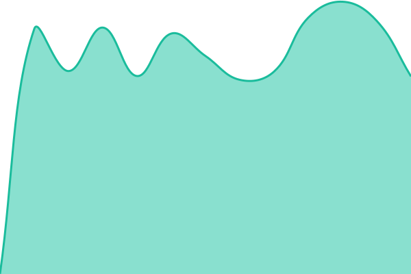
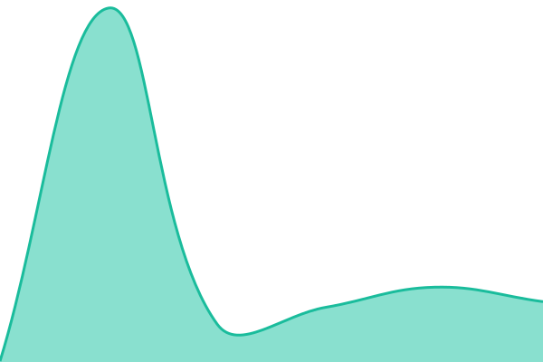
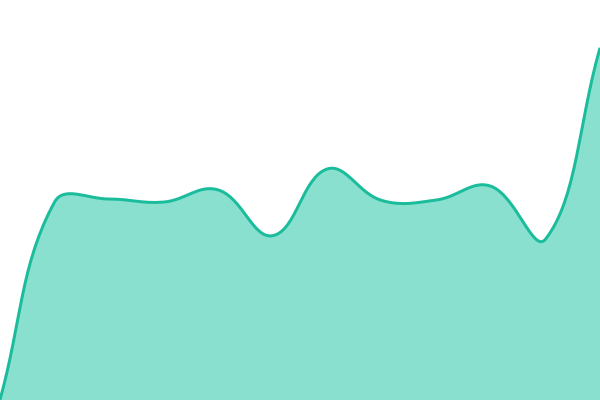
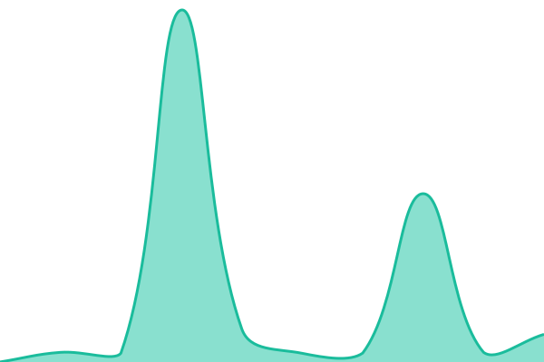

# [📈 Live Status](https://wokabout.github.io/upptime): <!--live status--> **🟩 All systems operational**

This repository contains the open-source uptime monitor and status page for [wokabout](https://wokabout.github.io/upptime), powered by [Upptime](https://github.com/upptime/upptime).

With [Upptime](https://upptime.js.org), you can get your own unlimited and free uptime monitor and status page, powered entirely by a GitHub repository. We use [Issues](https://github.com/wokabout/upptime/issues) as incident reports, [Actions](https://github.com/wokabout/upptime/actions) as uptime monitors, and [Pages](https://wokabout.github.io/upptime) for the status page.

<!--start: status pages-->
<!-- This summary is generated by Upptime (https://github.com/upptime/upptime) -->
<!-- Do not edit this manually, your changes will be overwritten -->
<!-- prettier-ignore -->
| URL | Status | History | Response Time | Uptime |
| --- | ------ | ------- | ------------- | ------ |
|  [FJ-AG](https://ag.gov.fj) | 🟩 Up | [fj-ag.yml](https://github.com/wokabout/fj-upptime/commits/HEAD/history/fj-ag.yml) | 

 1819ms
     
 | 

<a href="https://wokabout.github.io/fj-upptime/history/fj-ag">100.00%</a>
    

|  [FJ-MET](https://www.met.gov.fj) | 🟩 Up | [fj-met.yml](https://github.com/wokabout/fj-upptime/commits/HEAD/history/fj-met.yml) | 

 503ms
     
 | 

<a href="https://wokabout.github.io/fj-upptime/history/fj-met">100.00%</a>
    

|  [FJ-MOH](https://www.health.gov.fj) | 🟩 Up | [fj-moh.yml](https://github.com/wokabout/fj-upptime/commits/HEAD/history/fj-moh.yml) | 

 1315ms
     
 | 

<a href="https://wokabout.github.io/fj-upptime/history/fj-moh">100.00%</a>
    

|  [FJA-Digital](https://digital.fijiairways.com/booking/availability/0) | 🟩 Up | [fja-digital.yml](https://github.com/wokabout/fj-upptime/commits/HEAD/history/fja-digital.yml) | 

 132ms
     
 | 

<a href="https://wokabout.github.io/fj-upptime/history/fja-digital">100.00%</a>
    

|  [FJ-FRCS](https://frcs.org.fj/) | 🟩 Up | [fj-frcs.yml](https://github.com/wokabout/fj-upptime/commits/HEAD/history/fj-frcs.yml) | 

 1252ms
     
 | 

<a href="https://wokabout.github.io/fj-upptime/history/fj-frcs">100.00%</a>
    

|  [FJ-FRCS-Portal](https://tpos.frcs.org.fj/taxpayerportal/#/Logon/) | 🟩 Up | [fj-frcs-portal.yml](https://github.com/wokabout/fj-upptime/commits/HEAD/history/fj-frcs-portal.yml) | 

 351ms
     
 | 

<a href="https://wokabout.github.io/fj-upptime/history/fj-frcs-portal">100.00%</a>
    

|  [FJ-ImmiHub](https://immihub.immigration.gov.fj/FIDPortal/welcome) | 🟩 Up | [fj-immi-hub.yml](https://github.com/wokabout/fj-upptime/commits/HEAD/history/fj-immi-hub.yml) | 

 249ms
     
 | 

<a href="https://wokabout.github.io/fj-upptime/history/fj-immi-hub">100.00%</a>
    

|  [FJ-FNPF-Portal](https://myaccount.myfnpf.com.fj/ProMISMSS/wfmLoginExternal.aspx) | 🟩 Up | [fj-fnpf-portal.yml](https://github.com/wokabout/fj-upptime/commits/HEAD/history/fj-fnpf-portal.yml) | 

 3780ms
     
 | 

<a href="https://wokabout.github.io/fj-upptime/history/fj-fnpf-portal">83.62%</a>
    

|  [FJ-DNS1](ns1.fj) | 🟩 Up | [fj-dns-1.yml](https://github.com/wokabout/fj-upptime/commits/HEAD/history/fj-dns-1.yml) | 

 60ms
     
 | 

<a href="https://wokabout.github.io/fj-upptime/history/fj-dns-1">100.00%</a>
    

|  [FJ-DNS2](ns2.fj) | 🟩 Up | [fj-dns-2.yml](https://github.com/wokabout/fj-upptime/commits/HEAD/history/fj-dns-2.yml) | 

 60ms
     
 | 

<a href="https://wokabout.github.io/fj-upptime/history/fj-dns-2">100.00%</a>
    

|  [TFL-Drua](drua.tfl.com.fj) | 🟩 Up | [tfl-drua.yml](https://github.com/wokabout/fj-upptime/commits/HEAD/history/tfl-drua.yml) | 

 61ms
     
 | 

<a href="https://wokabout.github.io/fj-upptime/history/tfl-drua">100.00%</a>
    

|  [TFL-Tabua](tabua.tfl.com.fj) | 🟩 Up | [tfl-tabua.yml](https://github.com/wokabout/fj-upptime/commits/HEAD/history/tfl-tabua.yml) | 

 67ms
     
 | 

<a href="https://wokabout.github.io/fj-upptime/history/tfl-tabua">100.00%</a>
    

|  [Google DNS 1](8.8.4.4) | 🟩 Up | [google-dns-1.yml](https://github.com/wokabout/fj-upptime/commits/HEAD/history/google-dns-1.yml) | 

 24ms
     
 | 

<a href="https://wokabout.github.io/fj-upptime/history/google-dns-1">100.00%</a>
    

|  [Google DNS 2](8.8.8.8) | 🟩 Up | [google-dns-2.yml](https://github.com/wokabout/fj-upptime/commits/HEAD/history/google-dns-2.yml) | 

 24ms
     
 | 

<a href="https://wokabout.github.io/fj-upptime/history/google-dns-2">100.00%</a>
    

<!--end: status pages-->

[**Visit our status website →**](https://wokabout.github.io/upptime)

## 📄 License

- Powered by: [Upptime](https://github.com/upptime/upptime)
- Code: [MIT](./LICENSE) © [Anand Chowdhary](https://anandchowdhary.com)
- Data in the `./history` directory: [Open Database License](https://opendatacommons.org/licenses/odbl/1-0/)
